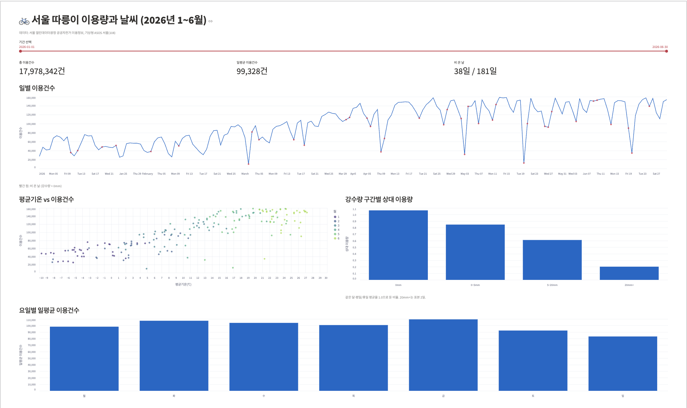
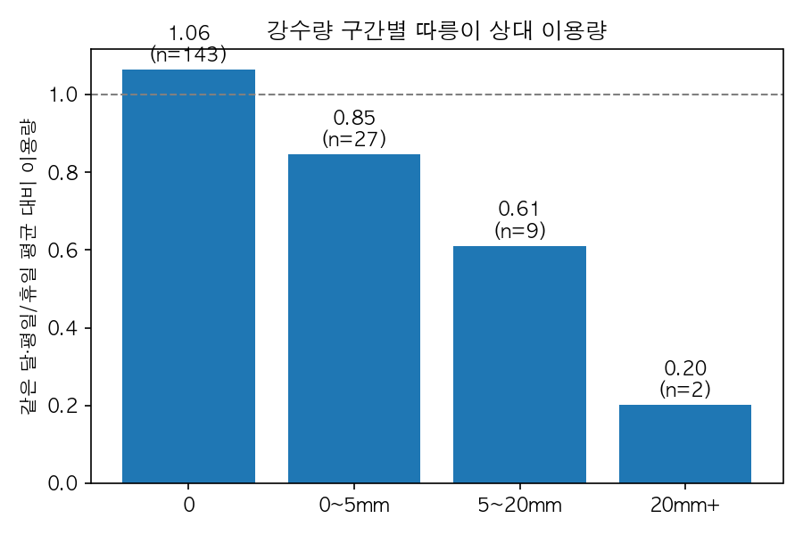

# 🚲 서울 따릉이 이용량과 날씨 분석 (2026년 1~6월)

> 비가 오면 따릉이 이용은 얼마나 줄어들까?
> 서울 공공자전거 일별 이용 데이터 181일치와 기상청 날씨 데이터를 결합해, 기온·강수·요일·휴일이 이용량에 미치는 영향을 분석했습니다.

**📊 대시보드:** https://seoul-bike-analysis.streamlit.app



---

## 핵심 결과

**1. 강수량이 많을수록 이용량이 단계적으로 감소합니다.**

같은 달·같은 평일/휴일 그룹의 평균 이용량을 1.0으로 두고 비교한 결과입니다.

| 강수량 | 일수 | 상대 이용량 |
|---|---:|---:|
| 0mm | 143 | 1.07 |
| 0~5mm | 27 | 0.85 |
| 5~20mm | 9 | 0.61 |
| 20mm 이상 | 2 | 0.20 |



강수량과 이용건수의 단순 상관계수는 -0.24에 불과했습니다. 하지만 대부분의 날이 강수량 0mm이고 계절·휴일 효과가 섞여 있어 실제 영향이 가려져 있었습니다. 같은 달·같은 요일 유형끼리 비교하자 효과가 뚜렷하게 드러났습니다. 단, 20mm 이상은 표본이 2일뿐이므로 정확한 수치보다는 경향으로 해석해야 합니다.

**2. 기온이 오를수록 이용량이 늘지만, 20℃ 부근부터 증가세가 둔화됩니다.**

평균기온과 이용건수의 상관계수는 0.82로 높습니다. 0~20℃ 구간에서는 거의 선형으로 증가하지만, 20℃를 넘는 6월에는 더 늘지 않았습니다. 4월에서 5월로 넘어가며 평균기온은 4.6℃ 올랐지만 일평균 이용량은 12.7만 건에서 12.6만 건으로 오히려 소폭 감소했습니다.

**3. 출퇴근 수요가 뚜렷합니다.**

휴일 평균(약 8.6만 건)이 평일 평균(약 10.6만 건)보다 약 19% 낮았습니다. 요일별로는 금요일이 가장 높고(약 10.9만 건) 일요일이 가장 낮았습니다(약 8.3만 건).

**4. 전날 대비 이용량이 가장 크게 떨어진 날은 대부분 비 온 날이었습니다.**

| 날짜 | 강수량 | 전날 대비 |
|---|---:|---:|
| 2026-05-20 | 63.1mm | -91.9% |
| 2026-03-02 | 12.2mm (대체공휴일) | -85.5% |
| 2026-04-09 | 18.9mm | -71.7% |
| 2026-05-03 | 14.8mm | -71.7% |

---

## 분석 과정

| 단계 | 내용 | 파일 |
|---|---|---|
| 데이터 준비 | 원본 6개 파일(약 1GB)을 일별로 집계하고 날씨 데이터와 병합 | `src/make_daily.py` |
| 탐색적 분석 | pandas·matplotlib로 기온·강수·요일·휴일 효과 분석 | `notebooks/01_eda.ipynb` |
| SQL 분석 | SQLite에 적재 후 CTE·윈도 함수로 같은 분석 재현 | `src/load_db.py`, `notebooks/02_sql.ipynb` |
| 대시보드 | Streamlit + Altair로 기간 필터가 있는 대시보드 제작·배포 | `app.py` |

pandas로 계산한 강수 구간별 상대 이용량을 SQL(`AVG() OVER (PARTITION BY 월, 휴일)`)로 다시 계산해 소수점 셋째 자리까지 같은 결과를 얻었습니다. 두 방법으로 교차 검증한 것입니다.

---

## 데이터

- **따릉이 이용 데이터:** 서울 열린데이터광장 「서울특별시 공공자전거 이용정보(일별)」, 2026년 1~6월
- **날씨 데이터:** 기상자료개방포털 ASOS 일자료, 서울(108) 관측소
- 원본 파일은 용량이 커서 저장소에 포함하지 않았습니다. 집계된 결과만 `data/`에 있습니다.

| 파일 | 내용 |
|---|---|
| `data/daily_bike_weather.csv` | 날짜별 이용건수·이동거리·이용시간 + 기온·강수량·풍속·습도·요일 (181행) |
| `data/daily_by_age.csv` | 날짜·연령대별 이용건수 |
| `data/daily_by_ticket.csv` | 날짜·대여구분별 이용건수 |

---

## 실행 방법

Python 3.10 환경에서 테스트했습니다.

```bash
pip install -r requirements.txt

# 대시보드 실행
streamlit run app.py

# SQLite DB 생성 (SQL 노트북용)
python src/load_db.py

# 원본 데이터에서 일별 집계 다시 만들기 (원본 파일 필요)
# <원본_데이터_폴더>에 따릉이 일별 원본 6개와 기상청 ASOS 파일을 함께 넣고 실행
python src/make_daily.py <원본_데이터_폴더> data
```

---

## 한계와 개선 방향

- **기간이 6개월뿐입니다.** 1~6월은 계절상 기온이 계속 오르는 시기라 기온 효과와 계절 효과를 완전히 분리하기 어렵습니다. 7~8월 폭염기 데이터가 있으면 "더우면 덜 탄다"는 가설을 검증할 수 있습니다.
- **강한 비가 내린 날의 표본이 적습니다.** 20mm 이상인 날이 2일뿐이라, 장기간 데이터를 쓰면 더 안정적인 추정이 가능합니다.
- **일 단위 집계입니다.** 밤에만 비가 온 날도 "비 온 날"로 분류됩니다. 시간대별 데이터를 쓰면 더 정확하게 분석할 수 있습니다.
- **다음 단계:** 기온·강수·요일·휴일을 함께 넣은 회귀 모델로 각 요인의 독립적인 효과를 추정하는 것.
